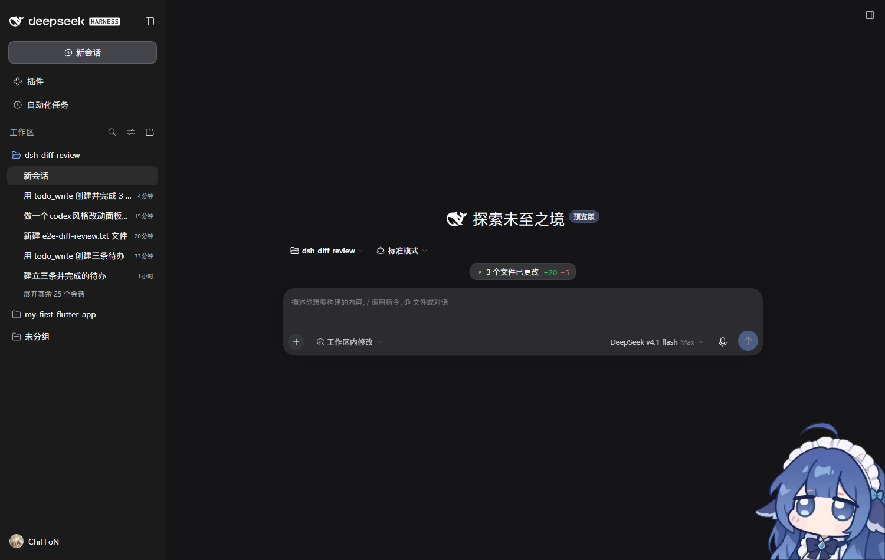
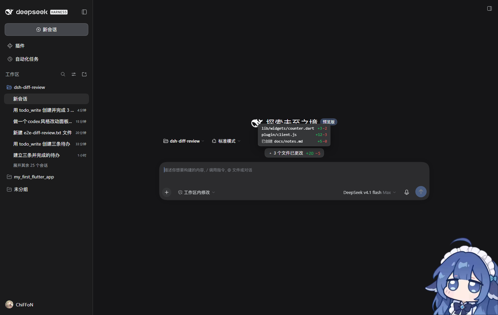
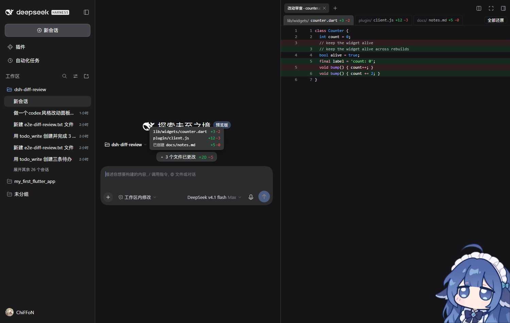

# dsh-diff-review

Codex-style change review for DeepSeek Harness. Whenever the agent edits files, a pill above the composer reports **N files changed +M −K** for that turn; hovering it floats the file list up, and the right sidebar shows each file's syntax-highlighted diff with a one-click revert.

English | [中文](README.zh.md)



- **A pill above the composer**: centered over the input box (not in a sidebar), counting only the files **the current turn** touched and resetting at each new turn.
- **One pill, nothing else**: `N files changed +M −K` — no separate "Review" or "Refresh" buttons. Hover opens the list, a file row opens the review page, and polling refreshes every 2 seconds.
- **Hover only**: moving into the dock floats the list up from above it and turns the caret up (`▴`); moving away fades it out. Clicking the pill itself changes nothing. The list is absolutely positioned, so it never pushes the composer down; in a short window its max height shrinks to the space above and the rest scrolls.
- **Per-turn counts**: edits to the same file within one turn are measured against that turn's starting content, for both the counters and the diff — not just the last edit.
- **Counters bump**: a small springy lift when a number changes (`prefers-reduced-motion` disables it).
- **The list hugs its content**: as wide as the longest file name, never a stretched empty right side; only a genuinely long path clamps at the composer width with an ellipsis.
- **Names left, counts right**: names start at one left edge; the two counter columns are right-aligned columns.
- **Above the native docks**: the pill sits above the native todo and queue docks, which keep their own appearance untouched.
- **Right-sidebar review page**: a tab strip along the top (browser-like tabs, scrollable sideways) and the whole area below is the selected file's diff — no side-by-side panes.
- **Syntax highlighting**: the language comes from the file extension (`dart`, `cpp`, `py`, `js`, `mjs`, …) and colors come from the client's own shiki highlighter and theme tokens; a not-yet-loaded grammar renders plain until it loads, then repaints.
- **Scroll performance**: diff rows are grouped 60 at a time into `content-visibility: auto` boxes, so off-screen groups skip layout and paint; highlighting and element construction are memoized per payload. A 2000-row diff scrolls at p50 16.7 ms / p95 17.7 ms per frame (containing every row individually instead degrades to p50 20.6 ms).
- **Conservative revert**: writes back only while the file still matches what was recorded, and reports a conflict instead of overwriting blindly.
- **Only the agent's own writes**: recorded from `edit` / `write` tool results (recognized by result shape, so Code-Mode sub-dispatches count too); `>` redirection or `sed -i` inside bash is not tracked.

The list that floats up on hover:



The review page: tabs on top, the whole diff below, colored by Dart grammar.



## Install

```sh
dsh plugin --profile web add dsh-diff-review
```

Restart the app afterwards (the plugin list is read at startup). In the desktop app, use your own profile name instead of `web`.

## Use

Just let the agent edit files. Once the pill appears during a turn:

- hover it to float the file list up, move away to dismiss (hover only; clicking the pill does nothing);
- click a file name to open the review page on that file in the right sidebar;
- switch files with the tabs at the top, and use "Revert all" to put this turn's changes back.

To remove it again, delete `dsh-diff-review` from the `dsh.profile.bundles` list in your profile's `package.json` and restart.

## API

All three routes are behind the browser session (the page calls them same-origin, so the cookie rides along):

| Method | Path | Purpose |
| --- | --- | --- |
| GET | `/api/diff-review.changes?sessionId=` | this turn's changed files + summed line counts |
| GET | `/api/diff-review.diff?sessionId=&path=` | one file's diff rows + both full sides (for whole-file highlighting) |
| POST | `/api/diff-review.revert` | `{ sessionId, paths? }`; omit `paths` for the whole turn |

## How it works

- `index.js` (Host): records `before`/`after` from a `tools/post-execute` listener, groups changes by turn from `session/event` `turn/start`, and serves the three routes above. The diff is computed in-house with an LCS walk, so it needs no `git` and works outside repositories.
- `client.js` (browser): the `conversation.input.dock` pill plus the `sidebar.right.pane.tab` review page, with a zh/en dictionary.
- `test/host.test.mjs`: Host-side unit tests — `node --test test/host.test.mjs`.
- UI regressions (each needs `BASE=… TOKEN=…` pointing at an instance with the plugin loaded):
  - `test/review.mjs`: review-page layout + syntax colors (stubbed data);
  - `test/popover.mjs`: hover open, upward placement, fade in/out, caret direction, click does nothing, composer stays put;
  - `test/order.mjs`: the pill sits above the native todo dock;
  - `test/shot.mjs`: dock screenshots and the name→counter gap;
  - `test/width.mjs`: the list hugs its content (`ONE=1` single row, `LONG=1` long path, `WIN=760,800` narrow window);
  - `test/counter.mjs`: counter right-alignment + the bump animation (`getAnimations()` proves it runs);
  - `test/multi-edit.mjs`: three edits to one file in one turn — asserts cumulative counts and the full diff;
  - `test/perf.mjs`: scroll frame times over a 2000-row diff (and the single-pill shape);
  - `test/dart.mjs` / `test/e2e.mjs`: end-to-end runs with a real turn.

## Known limits

- Records live in process memory: after a restart, older chats have no history diff until they run a new turn.
- Each session keeps the most recent 12 turns.
- Diffs are truncated past 4000 lines per side.
- Deleted files do not go through `edit`/`write`, so they are not shown as changes.
- Client-side `dsh.client` changes (new slots, bundle shape) **need an app restart**; editing `client.js` content does not hot-reload an already-open page (client-hmr only covers runtime-rebuilt bundles; installed plugins need a restart).

## License

[MIT](LICENSE)
